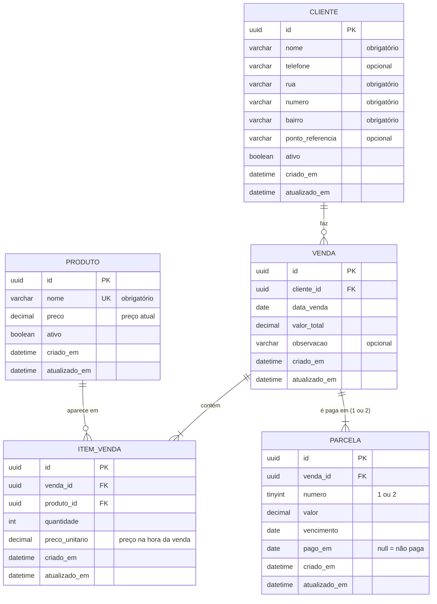

# Modelagem de dados — Vendas Detergente

Modelo do banco feito a partir do [levantamento de requisitos](requisitos.md). As regras citadas (RN01, RN02...) estão lá.

## Diagrama



## Entidades

### Cliente

| Coluna | Tipo MySQL | Tipo Java | Obrigatório | Observação |
|---|---|---|---|---|
| id | `BINARY(16)` | `UUID` | sim | PK |
| nome | `VARCHAR(100)` | `String` | sim | indexado para a busca |
| telefone | `VARCHAR(20)` | `String` | não | guardado só com dígitos; a tela deve incentivar preencher |
| rua | `VARCHAR(150)` | `String` | sim | |
| numero | `VARCHAR(10)` | `String` | sim | texto, porque existe "S/N", "12A" |
| bairro | `VARCHAR(80)` | `String` | sim | indexado (filtro por bairro no futuro) |
| ponto_referencia | `VARCHAR(255)` | `String` | não | RN10, observação do cliente |
| ativo | `BOOLEAN` | `boolean` | sim | padrão `true` |
| criado_em / atualizado_em | `DATETIME(6)` | `Instant` | sim | gravados em UTC |

### Produto

| Coluna | Tipo MySQL | Tipo Java | Obrigatório | Observação |
|---|---|---|---|---|
| id | `BINARY(16)` | `UUID` | sim | PK |
| nome | `VARCHAR(100)` | `String` | sim | único |
| preco | `DECIMAL(10,2)` | `BigDecimal` | sim | `> 0`, é o preço **atual** |
| ativo | `BOOLEAN` | `boolean` | sim | padrão `true` |
| criado_em / atualizado_em | `DATETIME(6)` | `Instant` | sim | |

### Venda

| Coluna | Tipo MySQL | Tipo Java | Obrigatório | Observação |
|---|---|---|---|---|
| id | `BINARY(16)` | `UUID` | sim | PK |
| cliente_id | `BINARY(16)` | `Cliente` | sim | FK → cliente |
| data_venda | `DATE` | `LocalDate` | sim | dia em que a venda aconteceu |
| valor_total | `DECIMAL(10,2)` | `BigDecimal` | sim | `> 0`, soma dos itens |
| observacao | `VARCHAR(255)` | `String` | não | RN10, observação da venda |
| criado_em / atualizado_em | `DATETIME(6)` | `Instant` | sim | |

### ItemVenda

| Coluna | Tipo MySQL | Tipo Java | Obrigatório | Observação |
|---|---|---|---|---|
| id | `BINARY(16)` | `UUID` | sim | PK |
| venda_id | `BINARY(16)` | `Venda` | sim | FK → venda |
| produto_id | `BINARY(16)` | `Produto` | sim | FK → produto |
| quantidade | `INT` | `int` | sim | `> 0` |
| preco_unitario | `DECIMAL(10,2)` | `BigDecimal` | sim | `> 0`, copiado do produto na hora (RN01) |
| criado_em / atualizado_em | `DATETIME(6)` | `Instant` | sim | |

Único: `(venda_id, produto_id)`. O mesmo produto não aparece duas vezes na venda, a quantidade é que aumenta.

### Parcela

| Coluna | Tipo MySQL | Tipo Java | Obrigatório | Observação |
|---|---|---|---|---|
| id | `BINARY(16)` | `UUID` | sim | PK |
| venda_id | `BINARY(16)` | `Venda` | sim | FK → venda |
| numero | `TINYINT` | `int` | sim | `1` ou `2` (RN03) |
| valor | `DECIMAL(10,2)` | `BigDecimal` | sim | `> 0` |
| vencimento | `DATE` | `LocalDate` | sim | |
| pago_em | `DATE` | `LocalDate` | não | `null` = ainda não foi paga |
| criado_em / atualizado_em | `DATETIME(6)` | `Instant` | sim | |

Único: `(venda_id, numero)`. Índice em `(pago_em, vencimento)` para a lista de devedores.

## Relacionamentos

| Relação | Cardinalidade | Por quê |
|---|---|---|
| Cliente → Venda | 1:N | um cliente compra várias vezes; uma venda é de um cliente só |
| Venda → ItemVenda | 1:N (pelo menos 1) | RN02 |
| Produto → ItemVenda | 1:N | |
| Venda ↔ Produto | N:N, resolvido pela **ItemVenda** | a tabela do meio guarda o que é da relação: quantidade e preço na hora |
| Venda → Parcela | 1:N (1 ou 2) | RN03 |

## Decisões e o porquê

**1. Preço guardado no item (RN01).** `produto.preco` é o preço de hoje e `item_venda.preco_unitario` é o preço do dia da venda. Se o produto passar de R$20 para R$22, as vendas antigas continuam certas.

**2. `valor_total` guardado na venda.** Daria para calcular somando os itens, e guardar um valor que pode ser derivado cria o risco de ele ficar desatualizado, principalmente porque a venda pode ser corrigida (RN13). Mesmo assim vale guardar:
- a lista de devedores e o histórico não precisam somar os itens toda vez;
- o app offline manda a venda pronta, e o servidor confere se o total bate com os itens.

Para o risco não virar bug, **só o service mexe no total**. Ao criar e ao corrigir uma venda, ele recalcula o total a partir dos itens e confere a RN04 (soma das parcelas = total) antes de salvar. O total nunca vem pronto da API.

**2.1. Correção de venda (RN13).** Corrigir uma venda substitui os itens e as parcelas dela, na mesma transação (`@Transactional`). Se der erro no meio, nada muda. O `preco_unitario` dos itens que continuam na venda não é atualizado para o preço atual: a venda continua com o preço da época (RN01).

**3. Situação da parcela calculada, sem coluna `status`.** A RN06 depende da data de hoje: uma parcela vira "atrasada" à meia-noite sem ninguém mexer nela. Uma coluna `status` ia ficar errada todo dia ou precisaria de um job para atualizar. A situação sai de dois campos:

| Situação | Condição |
|---|---|
| Paga | `pago_em IS NOT NULL` |
| Atrasada | `pago_em IS NULL AND vencimento < hoje` |
| Em aberto | `pago_em IS NULL AND vencimento >= hoje` |

No Java vira um enum `SituacaoParcela` devolvido por um método da entidade, sem ir para o banco.

Marcar como paga grava a data em `pago_em`. Desmarcar (RN14) volta `pago_em` para `null`, e a parcela fica em aberto ou atrasada de novo, conforme o vencimento.

**4. Pagamento parcial fica fora (RN12).** A parcela é paga inteira, então basta `pago_em`. Se um dia entrar o pagamento parcial, cria-se uma tabela `pagamento` (parcela 1:N pagamento) numa migration nova, sem quebrar o que existe.

**5. Venda à vista também tem parcela.** Se o cliente pagar na hora, a venda tem uma parcela com `vencimento = pago_em = data_venda`. Assim toda venda segue a mesma regra e a RN04 vale sempre.

**6. Endereço como colunas do cliente.** Cada cliente tem um endereço só, então uma tabela separada seria um join sem ganho. No Java ele vira um `@Embeddable Endereco` (rua, número, bairro, ponto de referência), o que deixa a classe `Cliente` organizada sem mudar o banco.

**7. Nada é apagado de verdade (RN08).** Cliente e produto têm `ativo`. "Excluir" vira `ativo = false`: some das listas e da tela de nova venda, mas o histórico continua. Venda e parcela não são excluídas. Isso também ajuda na sincronização: um registro apagado de verdade no servidor não teria como avisar os celulares que ele sumiu.

**8. UUID como `BINARY(16)` (RN11).** O UUID é gerado no celular, sem falar com o servidor. Comparando os formatos:
- `CHAR(36)` dá para ler direto no MySQL Workbench, mas ocupa 36 bytes e deixa os índices maiores;
- `BINARY(16)` ocupa 16 bytes e é o padrão do Hibernate 6 para `UUID` no MySQL, sem precisar de anotação extra.

Escolhi `BINARY(16)`. Para ler no Workbench: `SELECT BIN_TO_UUID(id), nome FROM cliente;`.

**9. `DECIMAL(10,2)` + `BigDecimal` para dinheiro.** `double` não representa 0,10 exatamente, e o erro aparece em somas. `DECIMAL` guarda o valor exato.

**10. `data_venda` separado de `criado_em`.** `data_venda` é a data do negócio. `criado_em` e `atualizado_em` são técnicos, para a sincronização saber o que mudou. Uma venda feita offline na segunda e sincronizada na quarta tem `data_venda` na segunda.

## Onde cada regra é garantida

| Regra | Banco | Service (Java) |
|---|---|---|
| RN01 preço da época | coluna `preco_unitario` | copia `produto.preco` ao criar o item |
| RN02 vários produtos | tabela `item_venda` | exige pelo menos 1 item |
| RN03 máx. 2 parcelas | `CHECK (numero IN (1,2))` + único `(venda_id, numero)` | exige 1 ou 2 parcelas |
| RN04 soma = total | (o banco não consegue checar entre linhas) | confere antes de salvar |
| RN06 atrasada | índice para a consulta | situação calculada |
| RN07 aviso de dívida | | consulta o saldo devedor do cliente antes da venda |
| RN08 sem exclusão | FKs sem `ON DELETE CASCADE` | só existe "desativar" |
| RN11 offline | ids `UUID`, `criado_em`/`atualizado_em` | aceita o id vindo do cliente |
| RN13 corrigir venda | | recalcula o total e confere a RN04, numa transação |
| RN14 desmarcar pagamento | `pago_em` aceita `null` | volta `pago_em` para `null` |

## Consultas principais

Saldo devedor de um cliente (RN07):

```sql
SELECT COALESCE(SUM(p.valor), 0)
FROM parcela p
JOIN venda v ON v.id = p.venda_id
WHERE v.cliente_id = ? AND p.pago_em IS NULL;
```

Lista de devedores, com as parcelas atrasadas primeiro:

```sql
SELECT c.nome, c.rua, c.numero, c.bairro, p.valor, p.vencimento
FROM parcela p
JOIN venda v ON v.id = p.venda_id
JOIN cliente c ON c.id = v.cliente_id
WHERE p.pago_em IS NULL
ORDER BY p.vencimento;
```

Ordenar pelo vencimento já coloca as atrasadas primeiro, porque são as de data mais antiga.
